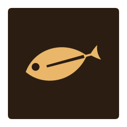
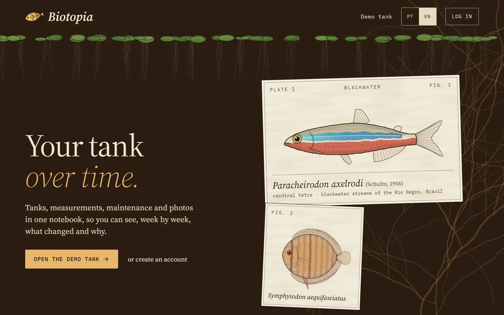
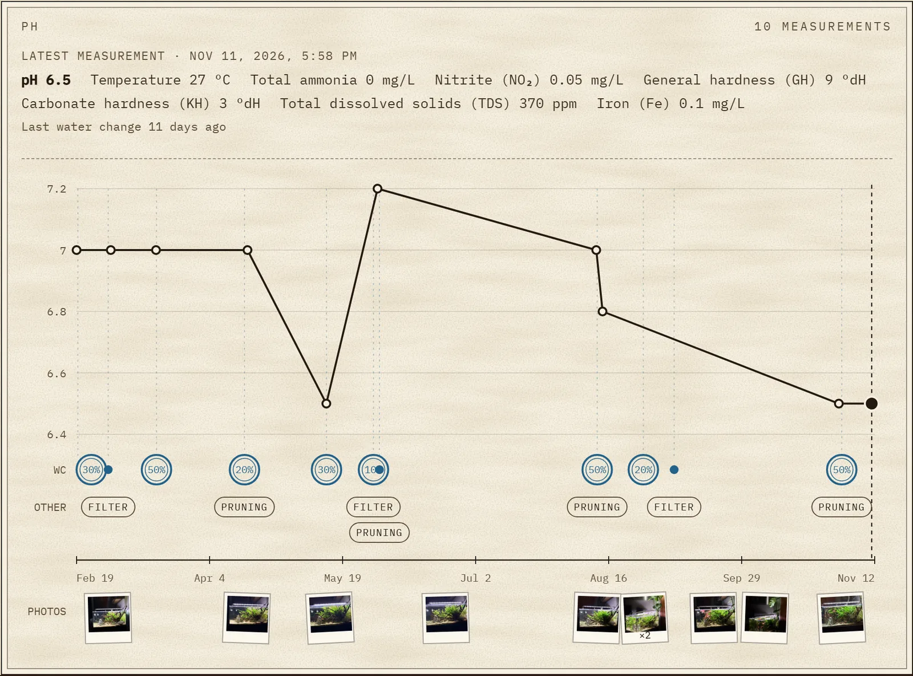
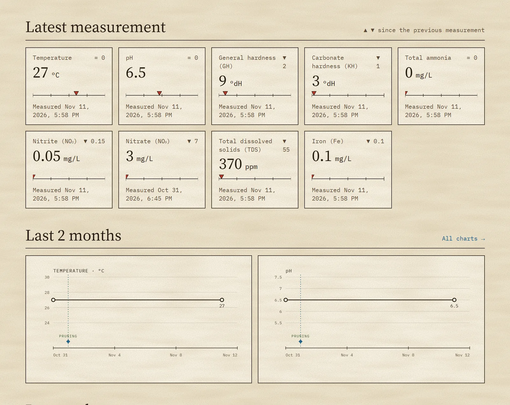
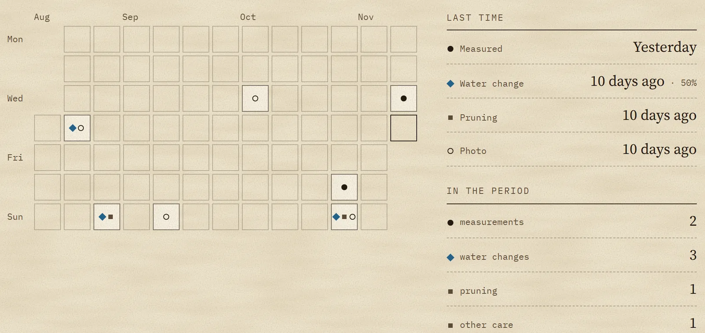
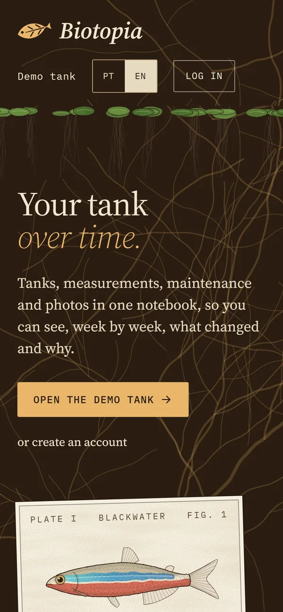
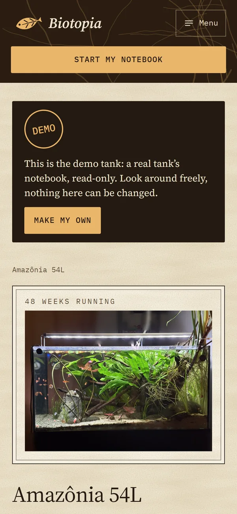
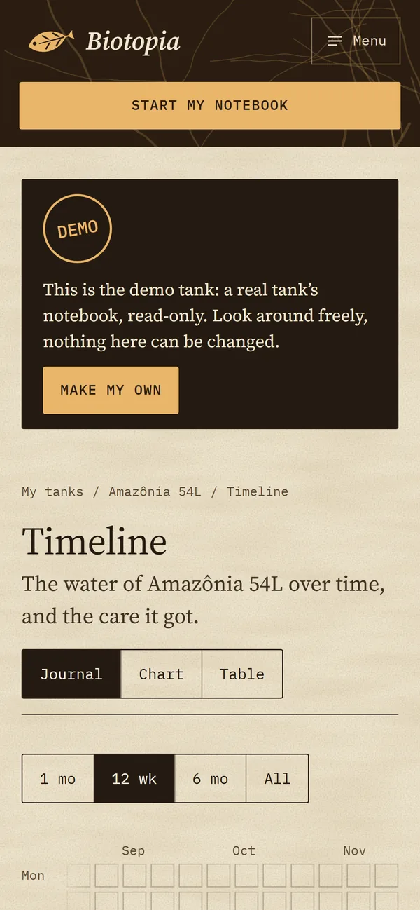
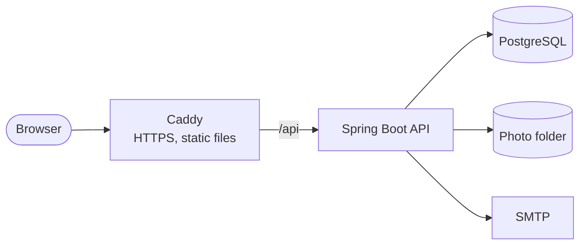

<p align="center">
  
</p>

<h1 align="center">Biotopia</h1>

<p align="center">
  A notebook for your aquarium: water tests, maintenance and photos on one timeline.
  <br>
  <a href="https://biotopia.fish/"><strong>biotopia.fish</strong></a>
  ·
  <a href="https://biotopia.fish/demo">Open the demo tank</a>, no account needed
</p>

<p align="center">
  
</p>

I keep a freshwater tank. My records were split between a notebook, my phone's notes and its photo gallery, and I
could never see measurements, maintenance and photos together over time. Biotopia puts all of it on one timeline,
so you can see, week by week, what changed and why.

Everything here runs in production at [biotopia.fish](https://biotopia.fish/).

## One timeline

Pick a parameter and see it next to everything you did to the tank: water changes with their percentage,
filter cleaning, pruning, and the photos you took on the same days.

<p align="center">
  
</p>

The [demo tank](https://biotopia.fish/demo) is my own tank, Amazônia 54L, with its real numbers. It is
read-only, so look around freely.

## What you can do

- **Tanks.** Name, start date, size and volume. If you don't know the net volume, it uses the gross volume
  worked out from the dimensions. Tanks can be archived, restored or deleted.
- **Measurements.** Eleven parameters: temperature, pH, GH, KH, total ammonia, nitrite, nitrate, phosphate,
  TDS, iron and potassium. Log several at once, with a comma or a dot, and see how each one moved since the
  last test.
- **Maintenance.** Water changes (percentage and litres), top-ups, filter and substrate cleaning,
  fertilizing, pruning. Several kinds at once if you did them together.
- **Photos.** Dated photos of the tank, grouped by month and placed on the charts.
- **Timeline.** Three views of the same period: a journal with a calendar, a chart per parameter, and a table.
- **Accounts.** Email confirmation, password reset, English and Brazilian Portuguese. Deleting your account
  deletes everything, photos included.

The page of a tank opens with the latest value of each parameter, how it moved since the test before, and the
last two months in charts:

<p align="center">
  
</p>

The journal shows what happened and when, on a calendar, with the last time each thing was done:

<p align="center">
  
</p>

On a phone it is the same notebook, in one column:

<p align="center">
  
  &nbsp;
  
  &nbsp;
  
</p>

## How it's built

| | |
| --- | --- |
| **Backend** | Java 21, Spring Boot 4, Spring Security, JPA, Flyway |
| **Database** | PostgreSQL |
| **Frontend** | React 19, TypeScript, Vite, Tailwind CSS 4, React Router, i18next |
| **Tests** | JUnit 5 and Testcontainers, Vitest, Playwright |
| **Deploy** | Docker Compose on one server, Caddy for HTTPS, GitHub Actions |
| **Pipeline** | Python, offline only (a script that imports a tank's history from a CSV) |



The backend is one application split into modules by package: `identity` (accounts, sessions, limits),
`tanks` (tanks, measurements, maintenance, photos), `email` and `web`. Most classes are package-private: of
about 70, only 8 are visible outside their module.

### Choices I'd point at

- **Tests run against a real PostgreSQL.** Every API test starts the whole app on a random port with a
  database in a container. The only things replaced are the clock and the email sender, so the tests can move
  time forward and read the emails the app sends. The code never calls `now()` on its own; it asks a `Clock`.
- **No chart library.** The charts are SVG drawn by hand, with their own scales and ticks. The frontend has
  four runtime dependencies: React, React DOM, React Router and i18next.
- **Photos lose their metadata.** Every upload is decoded, turned upright, resized to at most 2000 px and
  written again as a JPEG, so nothing from the original file (GPS position, camera, comments) is kept. Each
  account has a 200 MB quota.
- **Accounts.** Passwords are hashed with BCrypt, login and sign-up are rate-limited, and a password reset ends
  every open session.
- **Numbers and dates follow the language.** Values are stored in one unit and shown with the reader's decimal
  separator and date format. Any number field takes a comma or a dot.
- **Accessibility.** Status is never shown by color alone, motion stops when the system asks for less motion,
  and every chart has a text description.
- **Deploy on push.** A push to `main` runs the backend and frontend tests, builds two images, pushes them to
  GitHub's container registry and restarts the server over SSH. Caddy gets and renews the certificate.

Words like *Tank*, *Measurement* and *Parameter* have one meaning across the code and the UI; they are defined in
the [glossary](GLOSSARY.md). Decisions with lasting effects go in [`docs/adr/`](docs/adr/), and the visual
language is described in [`docs/ui.md`](docs/ui.md).

## Repository layout

```
backend/    Spring Boot API
frontend/   React single-page app
pipeline/   offline data work in Python
deploy/     Docker Compose file and settings template for the server
docs/       architecture decisions and the UI guide
GLOSSARY.md the words this project uses, and what they mean
```

## Running it locally

You need JDK 21, Node 22.12 or newer, and Docker.

Backend, with a throwaway PostgreSQL started by Testcontainers:

```bash
cd backend
./mvnw spring-boot:test-run
```

Or start the database with Docker Compose and run the app against it:

```bash
docker compose up -d
cd backend
./mvnw spring-boot:run
```

Frontend (calls to `/api` go to the backend on port 8080):

```bash
cd frontend
npm install
npm run dev
```

Without an SMTP server, the backend writes emails to its log, so you can open the confirmation link from there.

## Tests

```bash
cd backend && ./mvnw test
cd frontend && npm test
cd frontend && npx playwright install chromium && npm run test:e2e
```

About 190 backend tests, 160 frontend unit tests and 25 browser journeys. The browser tests start the backend
and the dev server on their own and read the emails from the backend log.

## Status

The project grows in phases, each one usable on its own. Phase 1, the tank manager, is done and running at
[biotopia.fish](https://biotopia.fish/). This repository is a snapshot of it; the next phases are built in a
private repository.

1. **Tank manager** (this repository). Accounts, tanks, measurements, charts, a maintenance log, photos and a
   public demo tank.
2. **Library and rules.** Species, plants and materials, with deterministic checks for parameters,
   compatibility and stocking. A public checker, no login.
3. **Biotope mode.** Pick a river or lake on a map and see the species, water parameters, plants and substrate
   of that place.
4. **Assistant.** The rules decide, a language model explains, and every answer cites its source. With no
   source, it says it does not know.
5. **3D planner.** Lay out a tank in simple 3D, checked against the library and the rules.

Focus on freshwater. The reasons are in [ADR 0001](docs/adr/0001-freshwater-only.md).

## Credits

Fonts: Source Serif 4, IBM Plex Mono and Caveat, under the SIL Open Font License. Everything made by someone
else is listed on the site's [credits page](https://biotopia.fish/credits).
